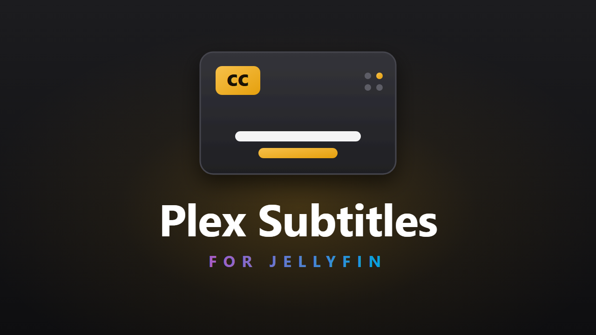
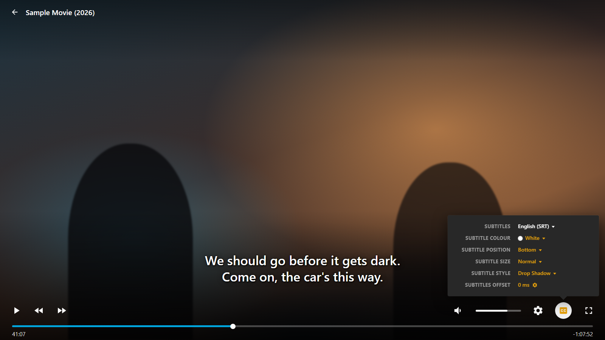

# Plex Subtitles for Jellyfin



Plex-style subtitle settings for Jellyfin. Click the **CC** button while you watch and change how your subtitles look, without leaving the video. Size, colour, position, style and timing all update live, the way they do in Plex.



## What you can change

| Setting | Choices |
| --- | --- |
| Subtitles | Any subtitle track on the video, or none |
| Secondary subtitles | A second track shown at the same time, for videos that support it |
| Subtitle colour | White, Yellow, Green, Cyan, Blue, Magenta, Red, Grey, Black |
| Subtitle position | Bottom, Raised, Middle, Top |
| Subtitle size | Tiny, Small, Normal, Large, Huge |
| Subtitle style | Drop Shadow, Outline, Box, Plain |
| Subtitles offset | Move subtitles earlier or later in 100 ms or 1 second steps |

Your choices are remembered on each browser, so every person in your household can have their own.

Subtitles also move up out of the way when the player controls appear, so the control bar never covers them.

## Install

You need Jellyfin 12.0 or newer.

1. In Jellyfin, go to **Dashboard**, then **Plugins**, then **Repositories**, and add a new repository:
   - **Name:** `Plex Subtitles Jellyfin`
   - **URL:**
     ```
     https://raw.githubusercontent.com/0vm/plex-subtitles-jellyfin/main/manifest.json
     ```
2. Open the plugin **Catalogue**, find **Plex Subtitles Jellyfin** under **General**, and click **Install**.
3. Restart Jellyfin.
4. Refresh Jellyfin in your browser.

Play anything with subtitles and click the **CC** button.

## Settings for server owners

Go to **Dashboard**, then **Plugins**, then **Plex Subtitles Jellyfin** to:

- turn the subtitle panel on or off for everyone
- choose the colour, position, size and style people start with before they pick their own
- turn off the "move above the controls" behaviour

## Where it works

- Jellyfin in a web browser. Tested in Chrome.
- Apps that open Jellyfin's web player, such as Jellyfin Media Player and the Samsung and LG TV apps, use the same player, so they should work too. They haven't been tested yet.
- It doesn't affect apps with their own video player, such as Swiftfin, Infuse or the Android TV app.
- Jellyfin 10.x is not supported.

## Good to know

- Colour, size, position and style apply to normal text subtitles (SRT, VTT). Styled ASS/SSA subtitles and picture-based subtitles (PGS, VobSub) keep their own look. The panel tells you when you are on one of those tracks. Track choice and offset still work for them.
- Subtitles that the server burns into the video can't be restyled.
- It works alongside other plugins such as Jellyfin Enhanced, JavaScript Injector and File Transformation, and doesn't need any of them.
- If the plugin ever can't show a subtitle line, Jellyfin's normal subtitles take over for that video, so you're never left without subtitles.

## Problems or ideas

Open an [issue](https://github.com/0vm/plex-subtitles-jellyfin/issues). Include your Jellyfin version, your browser, and what the subtitle track is (for example "English SRT").
